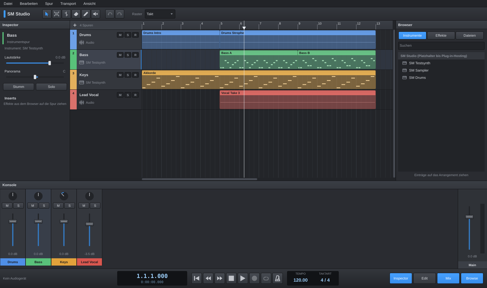

# SM Studio

Eine kostenlose, quelloffene, **lineare** Digital Audio Workstation für Windows und macOS –
im Bedienkonzept angelehnt an klassische lineare DAWs: Spuren, Events auf einer Zeitleiste,
Inspector links, Browser rechts, Konsole unten, Transportleiste unten.

> *A free, open-source, linear DAW for Windows and macOS, written in C++ with JUCE.*

**Status:** frühe Entwicklung (Etappe 1 – Grundgerüst). Noch nicht für echte Produktionen geeignet.
Siehe [Roadmap](docs/ROADMAP.md).



## Was schon geht

- Fenster mit Toolbar, Inspector, Arrangement, Browser, Konsole und Transportleiste
- Audio- und Instrumentenspuren anlegen, umbenennen, löschen, stumm/solo, Lautstärke und Panorama
- Drag & Drop aus dem Browser: Instrument → neue Instrumentenspur, Effekt → Insert auf der Spur,
  Audiodatei → Audiospur mit Event (auch direkt aus Explorer/Finder)
- Rückgängig/Wiederherstellen für alle Änderungen
- Audioausgabe mit Transport (Play/Stop/Positionieren) und Metronom
- Menüs und Tastaturkürzel kommen vollständig aus dem Modulsystem

Instrumente und Effekte im Browser sind bis zum Plug-in-Hosting (Etappe 3) Platzhalter.

## Tastaturkürzel

| Taste | Funktion |
|---|---|
| Leertaste | Wiedergabe / Stopp |
| Pos1 oder `,` | Zum Anfang |
| ← / → | Einen Takt zurück / vor |
| C | Metronom |
| T / Umschalt+T | Audio- / Instrumentenspur hinzufügen |
| Entf | Ausgewählte Spur löschen |
| ↑ / ↓ | Spur auswählen |
| M / S | Spur stumm / solo |
| 1 – 6 | Werkzeuge |
| Strg/Cmd+Z, Strg/Cmd+Umschalt+Z | Rückgängig / Wiederherstellen |
| F3 / F4 / F5 | Konsole / Inspector / Browser ein-/ausblenden |
| Strg/Cmd + Mausrad | Zoom |

## Herunterladen

Fertige Programme entstehen bei jedem Push automatisch:
**Actions** → neuester Lauf von „Build“ → unten unter *Artifacts*:

- `SM-Studio-Windows` – enthält `SM Studio.exe`
- `SM-Studio-macOS` – enthält `SM Studio.app.zip` (Universal: Apple Silicon und Intel)

**macOS-Hinweis:** Die App ist (noch) nicht von Apple notarisiert. Beim ersten Start
Rechtsklick → *Öffnen* wählen, oder im Terminal: `xattr -cr "/Applications/SM Studio.app"`.

## Selbst bauen

Voraussetzungen: CMake ≥ 3.22, ein C++20-Compiler (Visual Studio 2022, Xcode 15+ oder GCC 13+).
JUCE wird beim Konfigurieren automatisch heruntergeladen.

```bash
cmake -S . -B build -DCMAKE_BUILD_TYPE=Release
cmake --build build --config Release --parallel
ctest --test-dir build -C Release        # Unit-Tests
```

Unter Linux werden zusätzlich die JUCE-Abhängigkeiten benötigt (siehe `.github/workflows/build.yml`).

## Mitentwickeln

Wie das Programm aufgebaut ist und wie man neue Funktionen als Modul ergänzt, steht in
[docs/ARCHITECTURE.md](docs/ARCHITECTURE.md).

## Lizenz

SM Studio steht unter der **GNU Affero General Public License v3** (siehe [LICENSE.md](LICENSE.md)).
Es verwendet das [JUCE](https://juce.com)-Framework unter dessen AGPLv3-Lizenz.
„VST“ ist eine Marke der Steinberg Media Technologies GmbH. SM Studio steht in keiner
Verbindung zu PreSonus, Fender oder Steinberg.
